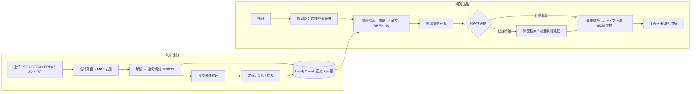

# 知库 ZhiKu


[](https://github.com/li202412/zhiku/actions/workflows/ci.yml)

把零散的文档变成「问一句就有答案、并能指出出处」的知识库问答系统。

工作流程是 **文档入库 → 混合检索 → 证据评估 → 带来源作答**。当知识库中没有相关资料时，系统会明确说明检索不到，而不是凭常识编造条款或数字。

---

## 项目简介

知库是一个面向中文文档的检索增强生成（RAG）系统。用户上传文档后，系统完成解析、切分、向量化并写入 Neo4j；提问时先由规划器决定检索策略，再通过向量检索与全文检索召回候选片段、用 RRF 融合排序，补充知识图谱证据并评估「现有证据是否足以作答」，最后由大语言模型基于上下文生成回答。

回答遵循三条约束：**只用检索到的资料作答**、**每个小节末尾用引用块标注来源文档**、**资料不足时明确拒答**。上下文中的资料编号仅供模型对应条目，不会出现在回答正文里。

系统由后端 API、前端界面与三个基础服务组成，可接入已有的 MySQL / Redis / Neo4j 本地运行（已验证），仓库同时提供了 Docker Compose 编排（构建验证暂缓，见「快速开始」说明）。

## 核心特性

| 特性 | 说明 |
| --- | --- |
| 多格式入库 | PDF / Word(.docx) / PPTX / Markdown / TXT，单文件上限 20MB，批量上传总上限 200MB |
| 去重与切分 | MD5 去重；递归字符切分（1000 字符 / 重叠 20），优先按段落、句号等分隔符切分 |
| 混合检索 | 向量召回与全文检索各取 `2 × limit` 候选，按 RRF（`k=60`，即 `1/(60+rank)`）融合排序 |
| 知识图谱 | 入库后异步抽取实体、关系与提及；检索时以图谱证据补充正文片段 |
| Agentic RAG | 规划 → 检索 → 可答性评估 → 证据融合 → 作答；证据不足时可补充检索或改用其他策略 |
| 可信回答 | 每节末尾 `> 来源：知识库《文档名》`；资料冲突时并列陈述并各自标源；未用知识库时也会说明 |
| 流式输出 | SSE 流式返回，事件类型 `thinking` / `response` / `done` / `error` |
| 多轮会话 | 会话与消息持久化，支持追问、历史会话列表与回放 |
| 用户隔离 | 检索 Cypher 强制带 `user_id` 过滤；JWT 鉴权 + Redis 令牌黑名单 |
| 容错降级 | 单步检索失败不阻塞其余步骤；Neo4j 不可用时主流程继续；模型未配置时服务仍可启动（AI 能力降级） |

## 技术栈

| 层 | 技术 |
| --- | --- |
| 后端 | Python 3.12+、FastAPI、LangChain / LangGraph、SQLAlchemy(aiomysql)、Uvicorn |
| 存储 | MySQL 8（用户 / 会话 / 消息）、Redis 7（令牌黑名单与缓存）、Neo4j 5（Chunk 向量与全文索引、知识图谱） |
| 前端 | React 19、TypeScript、Vite 8、Tailwind CSS 3、React Router 6、Zustand |
| 部署 | Docker Compose、Nginx（生产镜像托管前端并反向代理 API） |
| 依赖管理 | `uv`（后端）、`npm`（前端） |

## 系统架构



### 容错设计

| 环节 | 可能失败 | 当前处理 |
| --- | --- | --- |
| 解析 | 扫描件无文本、旧版 `.doc` | 明确报错并跳过，不写入脏数据；Word 仅支持 `.docx` |
| 切分 | 表格与长条款被切断 | 递归分隔符优先按段落 / 句号切分，保留页码元数据 |
| 检索 | 空召回、跨文档冲突 | 空召回先尝试兜底，仍无证据则明确说明「没有检索到」；冲突并列陈述并各自标源 |
| 图谱 | Neo4j 不可用 | 检索步骤逐条降级为空证据，主流程不中断；图谱接口返回 503 |
| 生成 | 幻觉、越权 | 强制「只用资料作答」+ 可答性闸门；用户隔离在 Cypher 层 |
| 流式 | 内部模型输出混入正文 | 只转发 `langgraph_node == "model"` 的模型事件 |

## 快速开始

### 前置条件

- **Docker 方式**：Docker Desktop（或 Docker Engine + Compose 插件）
- **本地开发**：Python 3.12+、`uv`、Node.js 20+、以及可用的 MySQL 8 / Redis 7 / Neo4j 5
- 一个 OpenAI 兼容协议的对话模型 API Key（用于回答生成）；嵌入模型可复用同一通道，也可单独配置

### 方式一：Docker Compose

```bash
cp backend/.env.example backend/.env
# 编辑 backend/.env，至少填写 OPENAI_API_KEY 与 OPENAI_MODEL_NAME

docker compose up -d --build
```

Windows 也可直接双击 `start.bat`（自动复制 `.env.example`、构建并等待后端就绪后打开浏览器），用 `stop.bat` 停止。

> 说明：Docker 方式当前**未在开发机上完成全栈构建验证**（基础镜像拉取受限），推荐先用下方「方式二」跑通；若构建卡在拉取基础镜像，见 `docs/PROBLEMS.md` 的 T8。

| 服务 | 地址 |
| --- | --- |
| 前端 | http://localhost:3000 |
| 后端 API / 交互式文档 | http://localhost:8000/docs |
| 默认演示账号 | `admin` / `admin1234`（仅本地体验，见「配置说明」） |

`docker compose down` 停止服务，数据保留在 Docker 数据卷与 `backend/` 目录。

### 方式二：本地开发

需要自行准备 MySQL / Redis / Neo4j，并先创建数据库：

```sql
CREATE DATABASE zhiku CHARACTER SET utf8mb4 COLLATE utf8mb4_unicode_ci;
```

```bash
# 终端 1：后端
cd backend
cp .env.example .env          # 按本机服务地址修改 MYSQL_* / REDIS_* / NEO4J_*
uv sync --extra dev
uv run uvicorn main:app --reload --port 8000

# 终端 2：前端
cd frontend
npm install
npm run dev                   # http://localhost:3000，API 代理到 127.0.0.1:8000
```

前端代理目标可用环境变量覆盖：`VITE_BACKEND_TARGET=http://127.0.0.1:8011 npm run dev`。

### 验证安装

```bash
curl http://localhost:8000/health
# {"message":"The service is healthy"}
```

## 配置说明

### 配置文件

后端所有配置从环境变量读取，统一在 `backend/app/core/settings.py` 定义，模板为 `backend/.env.example`。前端开发代理由 `frontend/vite.config.ts` 控制，默认指向 `http://127.0.0.1:8000`。

### 主要环境变量

| 分组 | 变量 | 说明 |
| --- | --- | --- |
| 对话模型（必填） | `OPENAI_BASE_URL` / `OPENAI_API_KEY` / `OPENAI_MODEL_NAME` | OpenAI 兼容协议，可接 DeepSeek、百炼 compatible-mode、智谱、Ollama 等 |
| 检索规划（可选） | `PLANNER_BASE_URL` / `PLANNER_API_KEY` / `PLANNER_MODEL_NAME` / `PLANNER_TIMEOUT_S` / `PLANNER_ENABLED` | 规划用快模型；`PLANNER_ENABLED=false` 走确定性检索（省一次模型调用） |
| 嵌入 / 视觉 / 重排 / 联网 | `EMBED_*` / `VISION_*` / `RERANKER_*` / `WEB_SEARCH_*` | 均为可选能力，未配置时按各自语义回落或降级 |
| 数据库 | `MYSQL_USER` / `MYSQL_PASSWORD` / `MYSQL_HOST` / `MYSQL_PORT` / `MYSQL_DATABASE` | 本地开发按本机填写 |
| 缓存 | `REDIS_HOST` / `REDIS_PORT` / `REDIS_DB` | 令牌黑名单与用户缓存 |
| 图数据库 | `NEO4J_URI` / `NEO4J_USER` / `NEO4J_PASSWORD` | 未配置时图谱功能降级 |
| 安全与运行 | `SECRET_KEY` / `ALGORITHM` / `CORS_ORIGINS` / `ENV` / `SEED_DEMO_USER` / `RATE_LIMIT_ENABLED` | JWT 签名密钥、跨域白名单、环境标识、演示账号开关、限流开关 |

完整的变量说明与跨平台混搭示例见 [`backend/.env.example`](backend/.env.example)。

### 注意事项

1. **Docker 下基础设施地址会被覆盖**：`docker-compose.yml` 自动把 `MYSQL_*` / `REDIS_*` / `NEO4J_*` 覆盖为容器内服务名与统一凭据，`.env` 只需填写 LLM 相关 Key；只有本地开发才需要按本机实际修改这些变量。
2. **规划模型的通道要成对配置**：`PLANNER_BASE_URL` 与 `PLANNER_API_KEY` 需同时填写，否则会回落到 `EMBED_*` → `OPENAI_*` 通道。此时 `PLANNER_MODEL_NAME` 必须是该通道可用的模型 ID，名字与通道不匹配会导致请求 404/429 后回落，白白增加数秒延迟。
3. **公网部署前务必**：设置 `ENV=prod`、`SEED_DEMO_USER=false`、`CORS_ORIGINS` 为实际前端域名，并换成 32 位以上的随机 `SECRET_KEY`。服务在检测到弱密钥或生产环境仍开启演示账号时会输出启动告警。

## 基本使用

### 通过 Web 界面

1. 访问 http://localhost:3000，用 `admin / admin1234` 登录（或在注册页创建账号）。
2. 进入「知识库」，上传 [`backend/samples/`](backend/samples/) 下的示例文档（差旅与住宿标准、费用报销流程、年假管理办法）。
3. 等待列表中的文档解析完成并显示切片数。
4. 进入「知识问答」，提问例如 `一线城市出差住宿标准是多少？`。
5. 回答以流式输出，末尾按小节给出 `> 来源：知识库《…》` 引用块；展开「思考步骤」可查看检索证据与各阶段耗时。

示例文档的用途与建议提问见 [`backend/samples/README.md`](backend/samples/README.md)。

### 通过 HTTP API

先登录取得 JWT（有效期 24 小时），后续请求在 `Authorization: Bearer <token>` 中携带：

```bash
# 1. 登录，记下返回的 token 字段
curl -s -X POST http://localhost:8000/user/login/ \
  -H 'Content-Type: application/json' \
  -d '{"username":"admin","password":"admin1234"}'

export TOKEN='<上一步返回的 token>'

# 2. 批量上传文档（multipart 字段名为 files；此接口以 SSE 返回处理进度）
curl -N -X POST http://localhost:8000/knowledge/add/multiple/stream \
  -H "Authorization: Bearer $TOKEN" \
  -F "files=@backend/samples/差旅与住宿标准.md" \
  -F "files=@backend/samples/费用报销流程.md"

# 3. 查看文档列表
curl -s http://localhost:8000/knowledge/list -H "Authorization: Bearer $TOKEN"

# 4. 发起流式问答（text/event-stream）
curl -N -X POST http://localhost:8000/chat/agent/query/stream \
  -H "Authorization: Bearer $TOKEN" \
  -H 'Content-Type: application/json' \
  -d '{"query":"一线城市出差住宿标准是多少？","session_id":null}'
```

问答接口返回 `data: {...}\n\n` 帧，`type` 为 `thinking` / `response` / `done` / `error`；`done` 帧携带 `session_id`，传入同一 `session_id` 即可继续多轮对话。

## 项目结构

```
ZhiKu/
├── backend/
│   ├── app/
│   │   ├── agent/            # Agent 工厂、中间件、search_rag 工具
│   │   ├── rag/
│   │   │   ├── agentic_rag/  # 规划 / 本地检索 / 可答性评估 / 证据融合
│   │   │   └── document_handler/  # 上传 → 解析 → 切分
│   │   ├── graph/            # Neo4j 存储、实体抽取、构建 worker、图谱接口
│   │   ├── router/           # chat / knowledge / user / health 路由
│   │   ├── models/           # User、ChatSession/ChatMessage、Graph* ORM
│   │   ├── prompt/           # 主提示词、RAG 上下文、规划与评估提示词
│   │   ├── config/           # 文档切分等配置
│   │   └── core/ db/ schemas/ services/ utils/   # 配置、数据库、数据模型、工具
│   ├── samples/              # 三份示例制度文档
│   ├── scripts/              # 评测与图谱维护脚本（见 scripts/README.md）
│   ├── tests/                # 后端测试
│   ├── .env.example          # 环境变量模板
│   └── pyproject.toml        # 依赖与工具配置（uv）
├── frontend/
│   ├── src/                  # pages / components / hooks / api / stores / i18n / router
│   ├── nginx.conf            # 生产镜像的反向代理配置
│   └── Dockerfile
├── docs/
│   ├── STATUS.md             # 现状：能力清单、架构、评测基线
│   ├── PLAN.md               # 后续计划、里程碑与风险
│   └── PROBLEMS.md           # 问题与解决方法、故障排查
├── docker-compose.yml        # mysql + redis + neo4j + backend + frontend
├── start.bat / stop.bat      # Windows 一键启动 / 停止
└── LICENSE
```

## API 参考

以下为常用接口，完整定义与在线调试见后端自动生成文档的 http://localhost:8000/docs 。

| 方法 | 路径 | 说明 |
| --- | --- | --- |
| POST | `/user/register/`、`/user/login/` | 注册 / 登录（返回 JWT，24h） |
| GET | `/user/detail/` | 当前用户信息 |
| PUT | `/user/update/` | 更新用户信息 |
| POST | `/user/logout/`、`/user/refresh-token/`、`/user/reset-password/` | 注销 / 刷新令牌 / 重置密码 |
| POST | `/chat/agent/query/stream` | 流式问答（SSE），请求体 `{ "query": "...", "session_id": null }` |
| GET | `/chat/sessions`、`/chat/session/{id}` | 会话列表 / 会话历史 |
| DELETE | `/chat/session/{id}` | 删除会话 |
| POST | `/knowledge/add/multiple/stream` | 批量上传并返回进度（前端使用，`files` 多部件字段） |
| POST | `/knowledge/add/multiple`、`/knowledge/add/single` | 批量 / 单文件上传 |
| GET | `/knowledge/list`、`/knowledge/detail`、`/knowledge/chunks` | 文档列表 / 详情 / 切片（后两者需 `filename` 查询参数） |
| DELETE | `/knowledge/clean`、`/knowledge/md5/clear` | 清空当前用户知识库 / MD5 记录 |
| GET | `/health` | 健康检查 |

除注册、登录与健康检查外，上述接口均需 `Authorization: Bearer <token>`。

## 测试与评测

```bash
cd backend
uv run pytest -q              # 后端测试；Neo4j 集成用例需配置 NEO4J_TEST_URI 才启用
uv run ruff check .           # 静态检查（E/F/I/W）

cd ../frontend
npm run build                 # TypeScript 类型检查 + 生产构建
```

后端测试覆盖 Agent 编排、SSE 帧序列、检索、图谱 worker、鉴权与 API；`ruff` 规则见 `pyproject.toml`。

`backend/scripts/` 提供脚本化的检索与答案质量评测（用法与破坏性说明见 [`backend/scripts/README.md`](backend/scripts/README.md)）：

```bash
cd backend
uv run python scripts/eval_ingest.py --n-query 100 --n-doc 2000   # 注入评测语料（n-doc 过小会让正例占比过高，指标虚高）
uv run python scripts/eval_recall.py --limit 10                  # Recall@k / Hit@k / MRR / nDCG@10
uv run python scripts/eval_end2end.py --n-samples 30             # faithfulness / correctness / 延迟
```

| 指标 | 脚本 | 基线（2026-11-19） |
| --- | --- | --- |
| Recall@5 / @10、MRR、nDCG@10 | `eval_recall.py` | 0.856 / 0.969、0.987、0.961 |
| 检索延迟 p95 | `eval_recall.py` | 326 ms |
| faithfulness / correctness（1–5） | `eval_end2end.py` | 4.97 / 4.97（95% CI ±0.07） |
| 来源块覆盖率 / 引用准确率 | `eval_end2end.py` | 100% / 97.5% |
| 拒答（明确拒答 / 谨慎作答 / 无依据硬答） | `eval_end2end.py` | 75% / 25% / 0% |
| 首 token / 端到端耗时 | `eval_end2end.py` | 474 ms / 2647 ms |

> 口径（必须连同数字一起引用）：检索为 DuRetrieval 子集，100 query / 2000 文档，**正例密度 23.1%**，因此 Recall/MRR 偏高，只用于版本间对比；答案与拒答为 30 正样本 + 20 负样本，裁判与主模型同为 `deepseek-chat`；拒答负样本取「相关文档不在入库池内」的 query，故该指标只作上界。详见 [`docs/STATUS.md`](docs/STATUS.md) 第五节。

## 路线图与已知限制

**当前限制**：Word 仅支持 `.docx`（不支持旧版 `.doc`）；扫描版 PDF 无 OCR，文本为空的文档会被跳过；权限为用户级隔离，暂无文档级私有 / 共享可见性控制；尚无 CI 质量门禁与请求级链路追踪；检索为同步调用，超大文档库需要引入异步任务与索引分片。

后续优先级：评测口径收口（拒答准确率、引用覆盖率）→ 检索期可见性控制 → 可观测性与成本台账 → Rerank 对照实验 → CI 质量门禁，详见 [`docs/PLAN.md`](docs/PLAN.md)。

当前能力边界与实测指标见 [`docs/STATUS.md`](docs/STATUS.md)；部署与使用中的常见故障、以及开发过程中修过的真实缺陷，见 [`docs/PROBLEMS.md`](docs/PROBLEMS.md)。

## 贡献指南

欢迎通过 Issue 报告问题或提出建议。提交改动前请：

1. Fork 仓库并基于 `main` 创建特性分支。
2. 后端改动运行 `uv run pytest -q` 与 `uv run ruff check .`；前端改动运行 `npm run build`。
3. 遵循现有风格：后端 `ruff`（E/F/I/W，Python 3.12）、前端 TypeScript + ESLint；新增接口或行为请补充对应测试。
4. 不要提交 `.env`、密钥、缓存、构建产物或 `docs/private/` 等本地文件（`.gitignore` 已配置）。
5. 提交 PR 时说明改动动机、影响范围与本地验证结果。

项目目前尚未配置 CI 门禁，上述检查需在本地完成。

## 许可证

本项目以 [MIT License](LICENSE) 开源。
