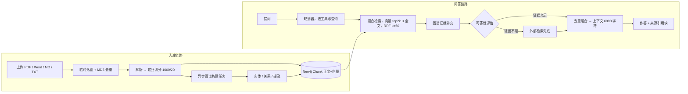

# 知库 ZhiKu — 企业文档知识库问答

把散落的制度、手册、规范文档变成「问一句就有答案、且能指到出处」的企业知识库。

解决的是很具体的场景：新员工查差旅标准要翻 200 页 PDF，HR 每天回答同样十个问题，两版制度互相打架却没人发现。知库把文档收进库里，回答时**先检索、再作答、并说明依据来自哪份文件**；资料不足时明确拒答，而不是编一段看起来合理的话。

> 定位：**企业文档 → 可信问答**。以 [RAGNotebook](https://github.com/RMA-MUN/RAGNotebook) 的检索内核为基座重构，保留入库管线 / 混合检索 / RRF 融合 / Agentic RAG 编排 / Neo4j 知识图谱，移除个人笔记、间隔重复、AI 写作、人工审批等个人向功能。

---

## 架构



链路上的**失败模式**与对应处理（也是面试最常追问的地方）：

| 环节 | 可能失败 | 当前处理 |
| --- | --- | --- |
| 解析 | 扫描件无文本、旧版 .doc | 明确报错并跳过，不写入脏数据；仅支持 .docx |
| 切分 | 表格/长条款被切断 | 递归分隔符优先按段落/句号切，保留页码元数据 |
| 检索 | 空召回、跨文档冲突 | 空召回先尝试外部兜底，仍无证据则明确说明「没有检索到」；证据冲突并列陈述并各自标来源 |
| 图谱 | Neo4j 不可用 | 检索步骤逐条降级为空证据（主流程不崩），回答明确说明证据不足；图谱构建任务按重试上限转 failed |
| 生成 | 幻觉、越权 | 强制「只用资料作答」+ 可答性闸门；用户级隔离在 Cypher 层 |
| 流式 | 内部模型输出泄漏 | 只转发 `langgraph_node=model` 的 token（见「失败复盘」） |

## 核心能力

| 能力 | 说明 |
| --- | --- |
| 多格式入库 | PDF / Word(.docx) / Markdown / TXT，单文件上限 20MB |
| 去重与切分 | MD5 去重；递归字符切分（1000 字符 / 重叠 20），保留页码与图片元数据 |
| 混合检索 | 向量召回（top 2×k）+ Lucene 全文（CJK 分词），**RRF k=60** 融合 |
| 知识图谱 | 入库后异步抽取实体/关系；检索时以图谱证据补充正文 |
| Agentic RAG | 规划 → 并行检索 → 可答性评估 → 证据融合 → 作答（可补充检索） |
| 可信回答 | 每节末尾用引用块标出**文档名**（`> 来源：知识库《文档名》`），资料不足时明说并给下一步 |
| 多轮对话 | 会话历史入库；追问可跨文档引用；右上角「新会话」 |
| 用户隔离 | 所有检索 Cypher 带 `node.user_id` 过滤；JWT 鉴权 + Redis 黑名单 |
| 降级策略 | 单步检索失败不阻塞其余步骤；模型未配置时服务仍可启动（AI 能力降级，页面与上传正常） |

## 关键取舍

**1. 用 Agentic RAG，而不是固定的「检索→拼接→回答」**
固定链路无法回答「检索到的这些够不够答」。加一层可答性评估后，系统能在证据不足时**拒答**或**换角度补检索**，这是「可信」与「像样」的分界线。代价是多一次模型调用（约 1 秒），换来的是幻觉率下降与拒答可解释。

**2. Neo4j 同时承担向量检索与知识图谱**
一个存储同时支持「chunk 向量/全文检索」和「实体—关系—提及」查询，避免向量库 + 图库双写一致性问题；图谱证据能给答案补上正文里没有的结构化上下文（实体类型、关联来源）。代价是必须自己维护索引与 Cypher 过滤。

**3. 回答不用 `[1]` 编号，用来源引用块**
编号需要读者来回对照，制度类问答里可读性更差。改成每节末尾 `> 来源：知识库《文档名》`，读者一眼知道这段出自哪份文件；上下文里的编号只用于模型对应条目，不进入正文。

**4. 不引入多 Agent 编排**
当前任务边界清晰（检索 + 作答），多 Agent 只会增加不确定性与调试成本。等出现「需要并行调研多来源并交叉验证」的真实需求再考虑。

## 评测

检索与答案质量都有脚本化的评测口径（`backend/scripts/`）：

| 指标 | 含义 | 脚本 |
| --- | --- | --- |
| Recall@k / Hit@k | top-k 内是否命中相关文档 | `eval_recall.py` |
| MRR / nDCG@10 | 排序质量（首个相关文档位置 / 排序增益） | `eval_recall.py` |
| faithfulness | 答案是否被证据支撑（LLM 裁判 1–5） | `eval_end2end.py` |
| correctness | 与参考答案的一致度（LLM 裁判 1–5） | `eval_end2end.py` |
| TTFB / 端到端延迟 | 首 token 与总耗时 | `eval_end2end.py` |
| 空召回率 / 拒答准确率 | 「不知道」是否说得对 | `eval_end2end.py` |

```bash
cd backend
uv run python scripts/eval_ingest.py --n-query 50 --n-doc 200   # 注入评测语料（DuRetrieval 子集）
uv run python scripts/eval_recall.py --limit 10                 # 检索指标
uv run python scripts/eval_end2end.py --n-samples 30            # 答案质量 + 延迟
```

> ⏳ **基线数字待首次评测固化**。此处刻意不写未实测的数字；跑完会把结果落到 `evals/results/<sha>.json` 并回填本表（见 [Roadmap](docs/ROADMAP.md) 的 P0-1）。

## 工程实践

- **测试**：`637 passed / 24 skipped`（Neo4j 集成用例需 `NEO4J_TEST_URI` 才启用），覆盖编排、SSE 帧序列、检索、图谱 worker、鉴权与 API。
- **静态检查**：`ruff`（E/F/I/W）零告警；前端 `tsc -b` + `vite build` 通过。
- **可观测（日志级）**：上传打印「加载 / 切分 / 入库」三段耗时；问答打印 `planner / retrieval / evaluator / total` 与首 token 时间。
- **SSE 协议**：`thinking`（阶段事件，含证据）/ `response`（增量正文）/ `done`（会话 id）/ `error`，前端用 `fetch + ReadableStream` 自解析。

### 失败复盘（真实修过的 bug）

**① 工具内部的模型输出污染回答正文**
- 现象：回答开头出现 `{"answerable": false, "confidence": 0.72...}` 片段。
- 根因：`search_rag` 工具内部会调用规划器/可答性模型，`astream_events` 把这些嵌套 LLM 的 token 当作回答转发。
- 修复：只转发 `metadata.langgraph_node == "model"` 的模型事件；回归用例 `test_get_agent_stream_response_ignores_nested_tool_model_tokens`。

**② 小文件上传后「解析为空」**
- 现象：几 KB 的 md/txt 上传成功但切片数为 0；几十页 PDF 却正常。
- 根因：上传用 `NamedTemporaryFile` 句柄写入后未关闭，小于缓冲区的内容还在用户态内存里，加载器读到空文件。
- 修复：写完立即关闭句柄再落盘；后续补充 `.md` 直读快路径（原先走 `unstructured`，首次上传要等数分钟）。

**③ 提示词重写时丢了 `{context}` 占位符**
- 现象：所有回答都不引用资料，像在凭常识作答。
- 根因：重写 RAG 上下文提示词时把 `{context}` 删了，检索结果从未进入提示词。
- 防线：`test_get_agent_stream_response_with_rag_context` 断言上下文必须出现在 system prompt 中——这条测试当场抓到了它。

## 安全边界与已知限制

**已做**：JWT 鉴权 + Redis 黑名单；检索强制带 `user_id`；Agent 工具全部只读；上传限流；`/search_rag` 单轮调用次数上限与去重护栏；错误信息不回显内部堆栈。

**未做（路线图里）**：部门/密级级 ACL（当前是企业内的「个人库」隔离）；提示词注入红队用例；请求级 trace 与成本台账；CI 质量门禁。这些在 [docs/ROADMAP.md](docs/ROADMAP.md) 中按 P0/P1 排期。

## 快速开始

### 一、Docker 一键启动

```bash
cp backend/.env.example backend/.env     # 填 OPENAI_*（对话）与 EMBED_*（嵌入）
start.bat                                # Windows；或 docker compose up -d --build
```

- 前端 http://localhost:3000 （默认账号 `admin / admin1234`（仅本地演示））
- 接口文档 http://localhost:8000/docs

`stop.bat` 停止，数据保留在 Docker 卷。

### 二、本地开发（已有 MySQL / Redis / Neo4j）

```bash
# 需先建库：CREATE DATABASE zhiku CHARACTER SET utf8mb4 COLLATE utf8mb4_unicode_ci;
cd backend && uv sync --extra dev && uv run uvicorn main:app --reload --port 8000
cd frontend && npm install && npm run dev      # http://localhost:3000，接口代理到 8000
```

### 三、5 分钟验证

1. 登录后进入「知识库」，把 `backend/samples/` 下三份制度拖进去（差旅 / 报销 / 年假）；
2. 等列表里状态从「解析中」变为 chunk 数（小文档约 4 秒）；
3. 回到「知识问答」问：`一线城市出差住宿标准是多少？报销又需要哪些材料？`
4. 回答应带表格、每节末尾有 `> 来源：知识库《…》`，展开「思考步骤」能看到检索证据与各阶段耗时。

## 项目结构

```
ZhiKu/
├── backend/
│   ├── app/
│   │   ├── agent/            # Agent 工厂、中间件、search_rag 工具
│   │   ├── rag/
│   │   │   ├── agentic_rag/  # 规划 / 本地检索 / 可答性评估 / 证据融合
│   │   │   ├── document_handler/  # 上传 → 解析 → 切分
│   │   │   └── text_spliter.py
│   │   ├── graph/            # Neo4j 存储、实体抽取、构建 worker、图谱接口
│   │   ├── router/           # chat / knowledge / user / health
│   │   ├── models/           # ChatSession/ChatMessage、User、Graph*
│   │   └── prompt/           # 主提示词、RAG 上下文、规划/评估提示词
│   ├── samples/              # 三份示例制度文档
│   ├── scripts/              # 评测（eval_*）与图谱回填
│   └── tests/                # 637 passed / 24 skipped
├── frontend/src/             # pages(AIChat/KnowledgeBase/...)、hooks/useSSE、api
├── docs/ROADMAP.md           # 路线图（评测 / ACL / 可观测 / 安全）
├── docker-compose.yml        # mysql + redis + neo4j + backend + frontend
└── start.bat / stop.bat
```

## 主要接口

| 方法 | 路径 | 说明 |
| --- | --- | --- |
| POST | `/user/register/`、`/user/login/` | 注册 / 登录（JWT，24h） |
| POST | `/knowledge/add/multiple` | 批量上传（`files` 多部件） |
| POST | `/knowledge/add/multiple/stream` | 带进度的流式上传（前端使用） |
| GET | `/knowledge/list` | 当前用户文档列表（chunk 数、预览） |
| POST | `/chat/agent/query/stream` | 问答 SSE（`thinking` / `response` / `done` / `error`） |
| GET | `/chat/sessions` | 当前用户会话列表 |
| GET | `/chat/session/{id}` | 会话历史 |
| DELETE | `/chat/session/{id}` | 删除会话 |

## 测试

```bash
cd backend && uv run pytest -q          # 637 passed, 24 skipped
cd backend && uv run ruff check .
cd frontend && npm run build            # tsc 类型检查 + 产物构建
```

## 路线图

下一步聚焦「可评测、可治理」：评测基线固化 → Rerank 三组对照 → 检索期 ACL → 全链路追踪 → CI 门禁。详见 [docs/ROADMAP.md](docs/ROADMAP.md)。

## 许可

本项目以 MIT 许可发布，见 [LICENSE](LICENSE)。

检索内核（入库管线、混合检索与 RRF 融合、Agentic RAG 编排、Neo4j 图谱存储）改造自 [RAGNotebook](https://github.com/RMA-MUN/RAGNotebook)（MIT），保留其原始版权声明；本项目在此基础上移除了个人笔记/复习/写作等模块，并重写了面向企业文档的提示词、界面与工程配套。二次分发请同样保留上述版权与许可声明。
